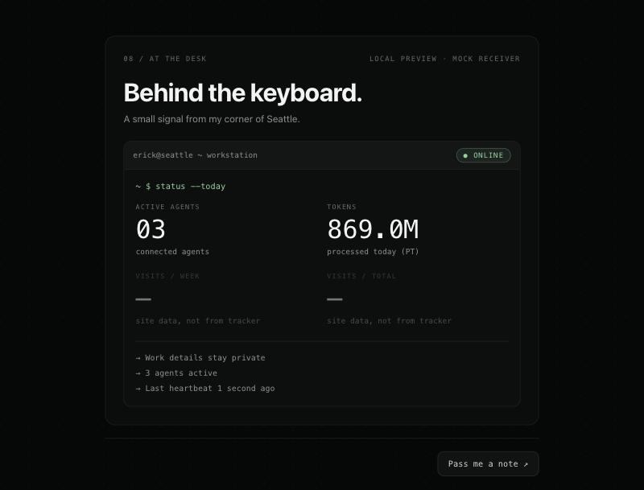
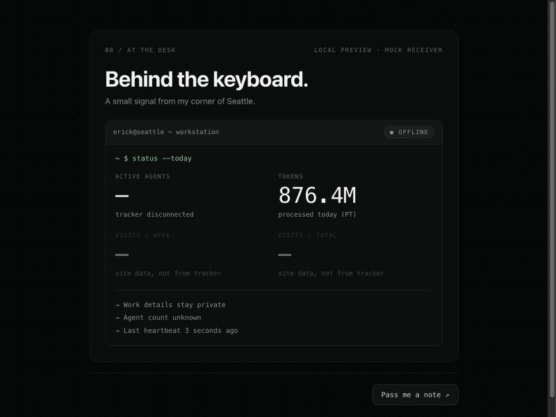
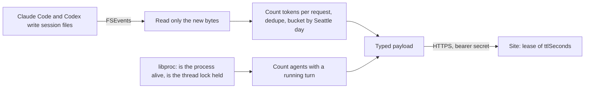

# agent-heartbeat

A small macOS daemon that reports two numbers to my portfolio site: **how many coding agents run now**, and **how many tokens they processed today**. It reads the local files of Claude Code and Codex, and it sends only aggregate counts. No prompt, project name, file path or identifier leaves the machine.

| Online, three agents running | Tracker stopped: Offline, count unknown |
|---|---|
|  |  |

*The panel preview from the mock receiver in this repository, with live data from my Mac. The visit counts belong to the site, so the preview leaves them empty.*

## What it costs to run

Measured on my Mac on 2026-10-02, while three agents worked:

| | |
|---|---|
| Binary | 1.3 MB, one file |
| Memory | 8–10 MB |
| CPU when no agent writes | none: the process sleeps until the next keepalive |
| CPU under heavy agent activity | 0.17% of one core, measured while 6 agents worked |
| First run, importing today's 1.15 GB of session files | 0.44 s |
| Child processes | none: process checks use `libproc` system calls instead of `ps` and `lsof` |
| Network | one small HTTPS POST on each change, plus one every 30 s while agents run, or every 120 s when none run |

## What leaves the machine

```json
{"schemaVersion":1,"type":"heartbeat","observedAt":"2026-10-02T17:52:31.651Z","ttlSeconds":90,"usageDate":"2026-10-02","timeZone":"America/Los_Angeles","agents":{"active":4,"coverage":"complete"},"tokens":{"input":857033951,"cachedInput":846812500,"output":3317298,"total":860351249,"coverage":"complete"}}
```

That is the whole payload: a real `agent-heartbeat dry-run` output. The payload is a Rust struct with fixed fields, so a field cannot leave unless the code declares it. The [JSON Schema](contract/heartbeat.v1.schema.json) rejects any other field. Tests plant marker strings in every content field of synthetic session files, and check that the markers never reach a payload, the state file or the log.

The tracker opens no port and follows no redirect. It reads Claude and Codex files read-only and never writes under `~/.claude` or `~/.codex`.

## How it works



- **Active agents.** An agent counts only while it runs a turn. Waiting for you, idle, or an open app does not count.
  - **Claude Code** keeps a registry of live sessions with a `busy`, `waiting`, `idle` or `shell` status. The tracker also checks the process start time, so a reused process ID cannot fool it.
  - **Child agents** count while their own file shows a turn in progress.
  - **Codex** records turn start and end events. The tracker counts a turn when it is the thread's latest and a live process holds the thread's lock.
- **Tokens today.** Total = processed input (cached input included) + output (reasoning included), from one record per model request. Repeated and replayed records count once. "Today" is the calendar day in Seattle, with daylight saving.
- **Freshness.** Each heartbeat carries a lease (`ttlSeconds`). The site shows Offline when the lease ends, or at once after a clean stop (lease 0).
- **Coverage.** If one source stops working, the payload says `partial`, and the numbers are a known subtotal. If none works, the numbers are `null`, never a false zero.

The full rules, the source formats, and the options I rejected (with measurements) are in [docs/DESIGN.md](docs/DESIGN.md). The site's side is in [docs/CONTRACT.md](docs/CONTRACT.md).

## Install

You need macOS and Rust (`brew install rust`).

```bash
cargo install --path .
```

```bash
agent-heartbeat status
```

`status` and `dry-run` work without any setup. They send nothing.

## Connect it to a site

1. Make a secret. It goes into your login Keychain, and the command prints only its SHA-256 for the site:

   ```bash
   agent-heartbeat secret generate
   ```

2. Store that hash on the site as `WORKSTATION_INGEST_SECRET_SHA256`. The site checks the SHA-256 of each bearer token against it.
3. Put the endpoint in `~/Library/Application Support/agent-heartbeat/config.json`:

   ```json
   { "endpoint": "https://erickbenitez.com/api/workstation/heartbeat" }
   ```

4. Start the tracker:

   ```bash
   agent-heartbeat start
   ```

**Optional: start at login.** The tool prints a per-user LaunchAgent. It installs nothing on its own.

```bash
agent-heartbeat launchd > ~/Library/LaunchAgents/io.github.erickb336.agent-heartbeat.plist
```

```bash
launchctl bootstrap gui/$(id -u) ~/Library/LaunchAgents/io.github.erickb336.agent-heartbeat.plist
```

## Commands

| Command | What it does |
|---|---|
| `status` | The local snapshot, per-source health and the last send result. Sends nothing. |
| `dry-run` | The exact JSON a heartbeat would send. Sends nothing. |
| `start` / `stop` | Run the tracker in the background, or stop it. A stop sends a last heartbeat with lease 0. |
| `run` | Run in the foreground (for launchd). |
| `secret generate` / `set` / `status` / `delete` | Manage the secret in the Keychain. |
| `launchd` | Print the LaunchAgent file. |

Private files, all mode 0600 in 0700 folders:

- **`~/Library/Application Support/agent-heartbeat/`:** `config.json`, and `state.json`, which holds the file cursors and hashed request keys for today and yesterday only.
- **`~/Library/Logs/agent-heartbeat/agent-heartbeat.log`:** state changes only. The log stops at about 512 KB.

## Uninstall

These steps remove the tracker and its own files. They do not touch Claude Code or Codex data.

```bash
agent-heartbeat stop
```

```bash
launchctl bootout gui/$(id -u)/io.github.erickb336.agent-heartbeat; rm -f ~/Library/LaunchAgents/io.github.erickb336.agent-heartbeat.plist
```

```bash
agent-heartbeat secret delete
```

```bash
rm -rf ~/Library/Application\ Support/agent-heartbeat ~/Library/Logs/agent-heartbeat
```

```bash
cargo uninstall agent-heartbeat
```

## Known limits

- **Codex waits for approval.** Codex records no event while a turn waits for approval, so such a turn counts as running. Codex hooks could close this gap, but they need a settings change.
- **Silent Claude child agents.** A Claude child agent that writes nothing for 10 minutes counts as stalled. Real child agents had a 99.9th-percentile silence of 3 minutes.
- **Undocumented formats.** Neither tool documents its session files as stable. Format knowledge lives in two files, `src/claude.rs` and `src/codex.rs`. A format change makes coverage `partial` or `unavailable`; it never produces a false zero.
- **Cloud sessions are invisible.** Claude Code on the web, Codex cloud and the Claude chat apps write nothing to this Mac, so they are not counted.

## Development

```bash
cargo test
```

```bash
cargo build --release && cd mock && npm ci && npm test
```

- **`cargo test`** runs the unit tests on synthetic files.
- **`npm test`** in `mock/` runs the receiver tests, and an end-to-end test of the real binary against synthetic sources and the mock receiver. Live `sleep` processes stand in for agents.
- **`node mock/server.js`** starts the mock receiver and its panel preview on 127.0.0.1.

## How it was built

I built this with Claude Code (Opus 5.5) as the lead agent, with subagents for research and for the mock receiver. The process went like this:

1. **Read the sources.** It checked the local Claude and Codex formats on my Mac, and the official docs for hooks and OpenTelemetry. It printed field names and counts, never content.
2. **Compare options with measurements.** It measured four runtimes and three wake-up and three send strategies on real data, and surveyed similar projects. The rejected options and their numbers are in [docs/DESIGN.md](docs/DESIGN.md#options-considered).
3. **Check against live data.** It compared the tracker's counts with an independent script on the same files. This found one wrong rule before release: an old Codex turn with no end event. That case is now a test.

## License

MIT. See [LICENSE](LICENSE).
