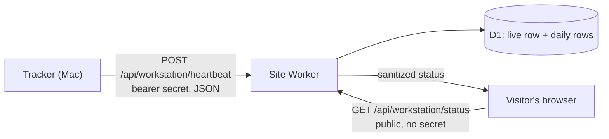

# Heartbeat contract, version 1

**Status:** proposal. Contract version 1 (`"schemaVersion": 1`), document revision 1, 2026-10-02. The production receiver does not exist yet.

This document tells the builder of erickbenitez.com how to receive heartbeats from `agent-heartbeat` and how to show them in the "Quiet terminal" panel. It is the only interface between the tracker and the site. The tracker sends aggregate numbers only: an active agent count, today's token counts, coverage and timestamps.

**What the Sites session must do:**

1. Build the receiver and the public status endpoint to this contract.
2. Run the [testing checklist](#testing-checklist) against the mock receiver, then against your build. The results must match.
3. Report any rule that the site cannot meet. Do not change the contract on your side only.

## Contents

- [Where it fits](#where-it-fits)
- [Endpoints](#endpoints)
- [Authentication](#authentication)
- [Messages](#messages)
- [Rules the schema cannot express](#rules-the-schema-cannot-express)
- [Freshness: a lease](#freshness-a-lease)
- [Receiver processing and response codes](#receiver-processing-and-response-codes)
- [Receiver responsibilities](#receiver-responsibilities)
- [Public status endpoint](#public-status-endpoint)
- [Display rules](#display-rules)
- [Corrections and backfill](#corrections-and-backfill)
- [Suggested Cloudflare Worker and D1 design](#suggested-cloudflare-worker-and-d1-design)
- [Versioning policy](#versioning-policy)
- [Testing checklist](#testing-checklist)
- [Files](#files)
- [Open questions](#open-questions)

## Where it fits

- **Goal.** The panel on erickbenitez.com shows how many Claude Code and Codex agents run now, and how many tokens they processed today (Seattle time).
- **Before this.** [DESIGN.md](DESIGN.md) defines the tracker: a small Rust binary on the owner's Mac. This repository holds the schema, samples and a mock receiver.
- **Next.** A separate session builds the receiver, the status endpoint and the panel on ChatGPT Sites. The site runs as a Cloudflare Worker with a D1 database.



| Part | Owner | Location |
|---|---|---|
| Tracker | This repository | `src/` (Rust) |
| Message schema | This repository | [`contract/heartbeat.v1.schema.json`](../contract/heartbeat.v1.schema.json) |
| Samples | This repository | [`contract/samples/`](../contract/samples/) |
| Mock receiver, panel preview, validator | This repository | [`mock/`](../mock/) |
| Receiver, status endpoint, panel | Sites session | erickbenitez.com |

The mock receiver is the reference behavior. When this document and the mock disagree, report it.

## Endpoints

| Method | Path | Authentication | Purpose |
|---|---|---|---|
| `POST` | `/api/workstation/heartbeat` | Bearer secret | The tracker sends messages. |
| `GET` | `/api/workstation/status` | None (public) | The panel reads the sanitized status. |

The proposed full address is `POST https://erickbenitez.com/api/workstation/heartbeat`. The paths are proposals. The tracker reads its endpoint from its configuration, so another path is easy. Tell the lead if you change a path.

## Authentication

- The tracker sends `Authorization: Bearer <secret>` with every message.
- The secret is a dedicated random value of 32 bytes. The owner runs `agent-heartbeat secret generate` on the Mac: it stores the secret in the Keychain and prints only its SHA-256. Use the secret for this endpoint only. Never reuse another credential.
- The site stores only the SHA-256 of the secret, as a hosting secret. Suggested name: `WORKSTATION_INGEST_SECRET_SHA256` (64 lowercase hex digits).
- To check a request, hash the presented token with SHA-256. Compare the two 32-byte digests in constant time, for example with `crypto.subtle.timingSafeEqual` in Cloudflare Workers.
- Never put the secret in a URL, a query string, a log, the frontend or a response.
- The plaintext secret never needs to leave the Mac. To rotate it, the owner runs `agent-heartbeat secret generate` again and replaces the hash on the site. Requests get 401 in between, and the tracker retries every 5 minutes.

## Messages

A message is one JSON object, UTF-8, at most 4,096 bytes. A typical heartbeat has about 300 bytes. The schema has `additionalProperties: false` at every level, so an unknown field makes the message invalid.

There are two message types:

| `type` | Purpose | Changes freshness and the active count? |
|---|---|---|
| `heartbeat` | A live observation: the active count, today's tokens and a lease | Yes |
| `dailyUsage` | A correction of one day's token totals | **No, never** |

**Fields**

| Field | In | Type | Meaning |
|---|---|---|---|
| `schemaVersion` | Both | `1` | The contract version. |
| `type` | Both | `"heartbeat"` or `"dailyUsage"` | The message type. |
| `observedAt` | Both | String: UTC, `Z` suffix, 0 to 3 fraction digits | The tracker's clock when it built the message. It orders messages. It never decides freshness. |
| `ttlSeconds` | Heartbeat | Integer, 0–600 | The lease. See [Freshness: a lease](#freshness-a-lease). `0` means the tracker stopped cleanly. |
| `usageDate` | Both | `YYYY-MM-DD` | The day in `timeZone` that the tokens belong to. |
| `timeZone` | Both | IANA zone name | Always `America/Los_Angeles` in version 1. |
| `agents.active` | Heartbeat | Integer 0–1000, or `null` | Agents with a running turn now. Agents that wait for the user do not count. |
| `agents.coverage` | Heartbeat | Coverage | How complete `active` is. |
| `tokens.input` | Both | Integer 0–10¹², or `null` | Processed input tokens. Cached input is included. |
| `tokens.cachedInput` | Both | Same | The part of `input` that came from the prompt cache. |
| `tokens.output` | Both | Same | Output tokens. Reasoning tokens are included. |
| `tokens.total` | Both | Same | `input + output`. |
| `tokens.coverage` | Both | Coverage | How complete the four numbers are. |

All numbers are counts of tokens or agents. There are no money values.

**Coverage**

| `coverage` | Meaning | Numbers | Panel |
|---|---|---|---|
| `complete` | Every configured source reported. | Exact | The number |
| `partial` | Some sources reported, and some did not. | A known subtotal: a lower bound | The number with `+`, for example `2+` |
| `unavailable` | No source reported. | `null` | `—` |

**Null rules.** A number is `null` exactly when its coverage is `unavailable`. Zero is a real value. `0` means "none". `null` means "unknown". The site must never show `null` as `0`.

**Example heartbeat** ([`heartbeat-complete.json`](../contract/samples/heartbeat-complete.json)):

```json
{
  "schemaVersion": 1,
  "type": "heartbeat",
  "observedAt": "2026-10-02T17:04:15.250Z",
  "ttlSeconds": 90,
  "usageDate": "2026-10-02",
  "timeZone": "America/Los_Angeles",
  "agents": { "active": 3, "coverage": "complete" },
  "tokens": { "input": 120000, "cachedInput": 96000, "output": 8400, "total": 128400, "coverage": "complete" }
}
```

**Example correction** ([`daily-usage-correction.json`](../contract/samples/daily-usage-correction.json)):

```json
{
  "schemaVersion": 1,
  "type": "dailyUsage",
  "observedAt": "2026-10-02T07:00:05.000Z",
  "usageDate": "2026-10-01",
  "timeZone": "America/Los_Angeles",
  "tokens": { "input": 755000000, "cachedInput": 702000000, "output": 312000, "total": 755312000, "coverage": "complete" }
}
```

## Rules the schema cannot express

The receiver applies these rules after the schema check. A message that breaks one gets 400. The error code goes into `details`.

| Rule | Error code |
|---|---|
| `schemaVersion` is `1`. The receiver checks this first. | `/schemaVersion: unsupported` |
| `tokens.total` = `tokens.input` + `tokens.output` | `/tokens/total: not_input_plus_output` |
| `tokens.cachedInput` ≤ `tokens.input` | `/tokens/cachedInput: exceeds_input` |
| `observedAt` names a real instant. The pattern alone allows `2026-02-30`. | `/observedAt: invalid_time` |
| `usageDate` is a real calendar date. | `/usageDate: invalid_date` |
| `timeZone` is a zone that `Intl` knows. | `/timeZone: unknown` |
| Heartbeat: `usageDate` is the date of `observedAt` in `timeZone`. | `/usageDate: not_observed_date` |
| Daily usage: `usageDate` is not after the date of `observedAt` in `timeZone`. | `/usageDate: future` |
| `timeZone` is the receiver's zone, `America/Los_Angeles`. Daily rows are keyed by a date in one zone. | `/timeZone: not_receiver_zone` |

Schema errors use the same form: `<JSON pointer>: <JSON Schema keyword>`, for example `/agents: additionalProperties`. Error codes name paths and rules only. They never repeat a value or an unknown field name from the request.

[`mock/validate.js`](../mock/validate.js) implements the schema check and these rules, except the receiver-zone rule, which is in [`mock/receiver.js`](../mock/receiver.js).

> **Note for Cloudflare Workers.** Workers do not allow code generation from strings at run time. Ajv compiles schemas with `new Function`, so `ajv.compile()` fails in a Worker. Use one of these:
>
> - Precompile the schema at build time with Ajv's standalone code generation, and bundle the result.
> - Write the checks by hand. Then test them against every file in `contract/samples/`.

## Freshness: a lease

Freshness uses the lease pattern, as in a Kubernetes Lease or a Consul TTL check. Each accepted heartbeat says how long it stays valid.

- The tracker is **connected** while `receivedAt + min(ttlSeconds, 300) × 1000 > now`. Both times come from the receiver's clock.
- `receivedAt` is the time when the receiver accepted the heartbeat. `observedAt` never decides freshness, because the Mac's clock can be wrong.
- Each accepted heartbeat replaces the lease. A short lease after a long one ends sooner.
- `ttlSeconds: 0` is a clean stop. The tracker is disconnected at once.
- The receiver caps each lease at 300 s (mock option `maxTtlSeconds`). The schema allows up to 600 s, so the cap is the receiver's choice.
- A `dailyUsage` message has no lease. It never changes freshness.

**Tracker cadence** (from [DESIGN.md](DESIGN.md#heartbeat-timing)):

| Tracker state | The tracker sends | `ttlSeconds` |
|---|---|---|
| At least one agent is active | A heartbeat at each change of the active count, and every 30 s | 90 |
| No agent is active | A heartbeat every 120 s | 300 |
| Clean stop | One heartbeat | 0 |
| The Mac sleeps, or the tracker crashes | Nothing | The last lease ends |
| After sleep or a network gap | A new observation at once | As above |

**Effects**

- A change of the active count reaches the site within about 5 s. The tracker combines file events over 5 s, then sends at once.
- If the tracker crashes while agents run, the site shows Offline within 90 s.
- While no agent runs, the panel shows Offline anyway. The slow idle lease changes only `0` versus `—` for up to 5 minutes after a crash.
- **Request rate:** at most about 2,900 heartbeats a day. Basis: 86,400 s ÷ 30 s = 2,880 keepalives when agents run all day, plus one for each change of the active count. A day with no agents sends 720 (86,400 s ÷ 120 s). These are estimates from the design, not measurements.

## Receiver processing and response codes

The receiver checks each `POST` in this order. It stops at the first failure.

1. **Authentication.** A missing or wrong secret gets 401.
2. **Rate limit.** More than 10 requests in 1 s gets 429 with `Retry-After: 1`. The mock counts authenticated requests only.
3. **Media type.** A `Content-Type` other than `application/json` gets 415. Parameters such as `; charset=utf-8` are allowed.
4. **Size.** A body larger than 4,096 bytes gets 413. Check `Content-Length` first. Stop reading as soon as the body passes the limit. For very large bodies, the connection can close before the client reads the 413.
5. **Syntax and contract.** Invalid UTF-8, invalid JSON, a schema failure or a rule failure gets 400.
6. **Clock skew.** If `|observedAt − receivedAt| > 120 s`, the message gets 422.
7. **Order.** A message that is not newer than the stored state gets 409. Nothing changes.
8. **Store.** The receiver stores the message and answers 204.

| Code | When | Body | What the tracker does |
|---|---|---|---|
| 204 | Accepted | None | Counts it as delivered. |
| 400 | Not JSON, or not a valid message | `{"error":"invalid","details":["<code>", …]}` | Logs the codes and drops the snapshot. The next scheduled send builds a new one. |
| 401 | Missing or wrong secret | `{"error":"unauthorized"}` | Waits 5 minutes between attempts. Logs once. |
| 403 | The site may use it to block a client | Any | Same as 401. |
| 409 | `observedAt` is not newer than the stored one | `{"error":"stale"}` | Counts it as delivered, but stale. No retry. |
| 413 | Body over 4,096 bytes | `{"error":"too_large"}` | Logs it and drops the snapshot. |
| 415 | Wrong `Content-Type` | `{"error":"unsupported_media_type"}` | Logs it and drops the snapshot. |
| 422 | Clock skew over 120 s | `{"error":"clock_skew"}` | Logs it and drops the snapshot. The next send has a new `observedAt`. |
| 429 | Too many requests | `{"error":"rate_limited"}`, header `Retry-After: 1` | Exponential backoff with full jitter: 2 s base, 60 s cap. |
| 5xx, timeout or network error | Server or network problem | Any | Same backoff as 429. |

- The tracker reads only the status code. The bodies are for people who test.
- Every retry is a **new** snapshot with a new `observedAt`. The tracker never replays an old message.
- The tracker does not follow redirects. A 3xx counts as a failure.
- If the Mac's clock is wrong by more than 120 s, every heartbeat gets 422 and the panel goes Offline. That is the correct signal.
- The mock answers 404 `{"error":"not_found"}` for every other method and path.

## Receiver responsibilities

| Responsibility | Rule |
|---|---|
| Validate | Check the schema and every rule above before you use a message. |
| Limit size | Reject bodies over 4,096 bytes. Stop reading early. |
| Check time | Reject `observedAt` more than 120 s from the receiver's clock. |
| Keep order | Accept a heartbeat only when its `observedAt` is newer than the last accepted heartbeat. Accept a day's totals only when `observedAt` is newer than that day's stored `observedAt`. Make the check part of the write, because two requests can run at the same time. |
| Record `receivedAt` | Use the receiver's clock. |
| Compute freshness | Use `receivedAt` and the capped lease only. Never use `observedAt`. |
| Store aggregates only | Store only the fields in [Storage model](#storage-model). Do not log request bodies, the `Authorization` header or IP addresses. Log method, path and status at most. |
| Publish sanitized status | The public endpoint returns only the fields in [Public status endpoint](#public-status-endpoint). |
| Show unknown as unknown | When the lease ends, the status is Offline and the count is `null` with coverage `unavailable`. Never `0`. |
| Keep daily totals separate | Store totals per `usageDate`. Replace them; never add to them. So retries cannot inflate them. |

### Storage model

| State | Content | Changed by |
|---|---|---|
| Live (one record) | `observedAt`, `receivedAt`, lease end, `agents.active`, `agents.coverage` | `heartbeat` only |
| Daily (one record per `usageDate`) | `input`, `cachedInput`, `output`, `total`, `coverage`, `observedAt`, `receivedAt` | `heartbeat` and `dailyUsage` |

- **Heartbeat.** If `observedAt` is not newer than the live `observedAt`, answer 409 and change nothing. Otherwise, replace the live record. Then replace the daily record for `usageDate` if `observedAt` is newer than that record's `observedAt`.
- **Daily usage.** Replace the daily record for `usageDate` if `observedAt` is newer than that record's `observedAt`. Otherwise answer 409. Never touch the live record.
- **Totals are snapshots, not deltas.** The tracker sends the whole day's total each time. A retry or a repeat therefore replaces a number with the same number.

## Public status endpoint

`GET /api/workstation/status` needs no authentication. It returns exactly these fields:

```json
{
  "schemaVersion": 1,
  "status": "online",
  "tracker": "connected",
  "agents": { "active": 3, "coverage": "complete" },
  "tokensToday": {
    "usageDate": "2026-10-02",
    "total": 128400,
    "input": 120000,
    "cachedInput": 96000,
    "output": 8400,
    "coverage": "complete"
  },
  "lastHeartbeatAt": "2026-10-02T17:04:15.900Z",
  "asOf": "2026-10-02T17:04:27.000Z"
}
```

| Field | Value |
|---|---|
| `schemaVersion` | `1`. The version of this response shape. |
| `status` | `"online"` when `tracker` is `"connected"` and `agents.active` ≥ 1. Otherwise `"offline"`. A partial count of 1 or more is online. |
| `tracker` | `"never"`: no heartbeat accepted yet. `"connected"`: the lease runs. `"disconnected"`: the lease ended, which includes a clean stop. |
| `agents` | When connected: `active` and `coverage` from the last accepted heartbeat. Otherwise: `{"active": null, "coverage": "unavailable"}`. |
| `tokensToday` | The daily record for today, or `null` when today has no record. "Today" is the date in `America/Los_Angeles` by the receiver's clock at request time. Yesterday's total never shows as today's. The record stays after a disconnection: it is today's total as of the last report. |
| `lastHeartbeatAt` | `receivedAt` of the last accepted heartbeat, in UTC with milliseconds, or `null`. |
| `asOf` | The receiver's clock when it built the response. |

- There are no other fields. Never copy fields from a message into the response.
- The mock sends `Cache-Control: no-store`. The site may cache the response for up to 5 s.
- Samples: [`status-online.json`](../contract/samples/status-online.json), [`status-idle.json`](../contract/samples/status-idle.json) and [`status-disconnected.json`](../contract/samples/status-disconnected.json).

## Display rules

The mock serves a preview of the panel at `GET /`. Its code is in [`mock/preview.html`](../mock/preview.html).

| Case | The panel shows |
|---|---|
| `status` is `"online"` | `● ONLINE` in soft green |
| `status` is `"offline"` | `● OFFLINE` in grey |
| Active count, coverage `complete` | Two digits: `03`, `00`. Caption: "connected agents". |
| Active count, coverage `partial` | The subtotal with `+`: `2+`. Caption: "known subtotal". |
| Active count `null` | `—`, never `0`. Caption: "tracker disconnected". |
| Tokens, coverage `complete` | Compact and rounded down: `999`, `128.4k`, `755.3M`. Caption: "processed today (PT)". |
| Tokens, coverage `partial` | With `+`: `128.4k+` |
| `tokensToday` is `null`, or `total` is `null` | `—` |
| Visits | Site data. The tracker does not send it. |
| Footer, agent line | "N agents active", "No agents running" (complete 0), "At least N agents active" (partial), "Agent count unknown" (`null`) |
| Footer, heartbeat line | "Last heartbeat N seconds ago", from `asOf − lastHeartbeatAt`, so the visitor's clock does not matter. "No heartbeat yet" when `lastHeartbeatAt` is `null`. |

- Online appears only when the tracker is connected **and** at least one agent runs.
- Token counts are not a bill. Do not show money or subscription limits.
- Rounding down never overstates a lower bound.

## Corrections and backfill

The tracker sends a `dailyUsage` message to correct one day's totals. Examples:

- After midnight, for the day that just ended. A heartbeat carries only today's tokens, so late records for yesterday need a correction.
- After a restart, when the tracker reads its files again.

Rules:

- The receiver replaces that day's record when `observedAt` is newer than the stored `observedAt`. Otherwise it answers 409.
- A correction never changes the live record: not the lease, not the active count, not `lastHeartbeatAt`. So a correction can never make the panel look live.
- A correction for a past date never shows as today's total, because the status shows only today's date.
- A correction for a future date fails validation (`/usageDate: future`).
- The tracker keeps state for today and yesterday only, so it corrects only those dates. The receiver accepts any past date.
- Version 1 has no bulk backfill of older history.

## Suggested Cloudflare Worker and D1 design

This is a suggestion. Any design that meets the rules above is acceptable.

**Hosting secret:** `WORKSTATION_INGEST_SECRET_SHA256`.

**Tables.** Store times as integer milliseconds. Do not compare ISO strings: the format allows 0 to 3 fraction digits, so string order is not time order.

```sql
CREATE TABLE workstation_live (
  id              INTEGER PRIMARY KEY CHECK (id = 1),  -- one row only
  observed_at_ms  INTEGER NOT NULL,                    -- tracker clock; orders heartbeats
  received_at_ms  INTEGER NOT NULL,                    -- receiver clock
  lease_until_ms  INTEGER NOT NULL,                    -- received_at_ms + min(ttlSeconds, 300) * 1000
  agents_active   INTEGER,                             -- NULL when coverage is 'unavailable'
  agents_coverage TEXT NOT NULL CHECK (agents_coverage IN ('complete', 'partial', 'unavailable'))
);

CREATE TABLE workstation_daily (
  usage_date      TEXT PRIMARY KEY,                    -- YYYY-MM-DD, America/Los_Angeles
  input           INTEGER,
  cached_input    INTEGER,
  output          INTEGER,
  total           INTEGER,
  coverage        TEXT NOT NULL CHECK (coverage IN ('complete', 'partial', 'unavailable')),
  observed_at_ms  INTEGER NOT NULL,
  received_at_ms  INTEGER NOT NULL
);
```

**Writes.** Put the order check into the write. Then two requests at the same time cannot both win.

```sql
-- Heartbeat, step 1. If meta.changes is 0, answer 409 and stop.
INSERT INTO workstation_live (id, observed_at_ms, received_at_ms, lease_until_ms, agents_active, agents_coverage)
VALUES (1, ?1, ?2, ?3, ?4, ?5)
ON CONFLICT (id) DO UPDATE SET
  observed_at_ms = excluded.observed_at_ms, received_at_ms = excluded.received_at_ms,
  lease_until_ms = excluded.lease_until_ms, agents_active = excluded.agents_active,
  agents_coverage = excluded.agents_coverage
WHERE excluded.observed_at_ms > workstation_live.observed_at_ms;

-- Heartbeat, step 2 (only after step 1 changed a row). Daily usage: this statement only;
-- if meta.changes is 0, answer 409.
INSERT INTO workstation_daily (usage_date, input, cached_input, output, total, coverage, observed_at_ms, received_at_ms)
VALUES (?1, ?2, ?3, ?4, ?5, ?6, ?7, ?8)
ON CONFLICT (usage_date) DO UPDATE SET
  input = excluded.input, cached_input = excluded.cached_input, output = excluded.output,
  total = excluded.total, coverage = excluded.coverage,
  observed_at_ms = excluded.observed_at_ms, received_at_ms = excluded.received_at_ms
WHERE excluded.observed_at_ms > workstation_daily.observed_at_ms;
```

**Reads.** The status endpoint reads the live row and today's daily row. It computes `connected` as `lease_until_ms > Date.now()` at request time. No scheduled job is necessary.

**Rate limit.** A counter in Worker memory is per isolate, so it is not a global limit. Use the Workers rate-limiting binding or a WAF rule.

**Load estimate.**

| Item | Estimate | Basis |
|---|---|---|
| Heartbeats | At most about 2,900 a day; 720 on a day with no agents | 30 s keepalive while agents run; 120 s while idle |
| Row writes | At most about 5,800 a day | 2 rows for each heartbeat (live + daily) |
| Daily rows | One for each day: about 365 a year | One row per `usageDate` |
| Status reads | 2 rows for each request; depends on visitors | A panel that polls every 15 s makes 240 requests an hour for each open tab |

Compare these numbers with the current limits of your plan. Cloudflare's D1 free tier publishes a daily limit for rows written. This document did not check the current value, and the limits of ChatGPT Sites hosting are not known to this project. For the site panel, poll every 10–15 s and stop while the tab is hidden. The mock's preview polls every 2 s for local tests only.

## Versioning policy

- `schemaVersion` is an integer. The receiver accepts only versions that it implements. It rejects any other version with 400 and `/schemaVersion: unsupported`.
- Every change to a message needs a new `schemaVersion`. This includes an added field, because `additionalProperties: false` makes every additive change a breaking change.
- Rollout order: the receiver adds the new version and keeps the old one. Then the tracker changes. The receiver removes the old version after the tracker stops sending it.
- The status response has its own `schemaVersion`. The same rules apply to it and to the panel.
- A clarification that does not change the wire format increases only the revision of this document.

## Testing checklist

Run these steps against the mock. Then run them against your build with your own base URL and test secret. The results must match.

**Start the mock** (Node 22 or later). The secret below is a placeholder for local tests. Never use a real secret in a command line.

```sh
cd mock && npm install
MOCK_RECEIVER_SECRET=placeholder-local-test-secret-not-real-0000 node server.js --port 8787
```

The preview is at <http://127.0.0.1:8787/>. Add `--max-ttl-seconds 5` to watch a lease end after 5 s.

**Helpers.** Run these in a second shell, in the repository root. `stamp` prints a sample with `observedAt` set to now; for a heartbeat, it also sets `usageDate` to today in Seattle. `post` sends standard input and prints the status code.

```sh
BASE=http://127.0.0.1:8787
SECRET=placeholder-local-test-secret-not-real-0000
S=contract/samples

# stamp FILE [OFFSET_MS]
stamp() {
  node -e '
    const m = JSON.parse(require("fs").readFileSync(process.argv[1], "utf8"));
    const t = Date.now() + Number(process.argv[2] || 0);
    m.observedAt = new Date(t).toISOString();
    if (m.type === "heartbeat")
      m.usageDate = new Intl.DateTimeFormat("en-CA", { timeZone: "America/Los_Angeles" }).format(t);
    process.stdout.write(JSON.stringify(m));
  ' "$1" "${2:-0}"
}

# post: AUTH and TYPE override the secret and the content type for one call.
post() {
  curl -sS -o /dev/null -w '%{http_code}\n' -X POST "$BASE/api/workstation/heartbeat" \
    -H "Authorization: Bearer ${AUTH:-$SECRET}" -H "Content-Type: ${TYPE:-application/json}" \
    --data-binary @-
}

status() { curl -sS "$BASE/api/workstation/status"; echo; }
```

**Steps.** Wait 1 s between steps if you run them as one script, or step 12 starts early.

| # | Command | Expected result |
|---|---|---|
| 1 | `status` | `"status":"offline"`, `"tracker":"never"`, `"active":null`, `"tokensToday":null` |
| 2 | `stamp $S/heartbeat-complete.json \| post` | `204` |
| 3 | `status` | `"online"`, `"connected"`, `"active":3`, `"total":128400` |
| 4 | `B=$(stamp $S/heartbeat-complete.json); echo "$B" \| post; echo "$B" \| post` | `204`, then `409` (a replay changes nothing) |
| 5 | `stamp $S/heartbeat-complete.json \| AUTH=wrong-secret post` | `401` |
| 6 | `stamp $S/heartbeat-complete.json \| TYPE=text/plain post` | `415` |
| 7 | `head -c 5000 /dev/zero \| tr '\0' ' ' \| post` | `413` |
| 8 | `stamp $S/invalid-extra-nested-field.json \| curl -sS -X POST "$BASE/api/workstation/heartbeat" -H "Authorization: Bearer $SECRET" -H 'Content-Type: application/json' --data-binary @-` | `{"error":"invalid","details":["/agents: additionalProperties"]}` |
| 9 | `stamp $S/heartbeat-complete.json -600000 \| post` | `422` (observedAt 10 minutes old) |
| 10 | `stamp $S/daily-usage-correction.json \| post`, then `status` | `204`. `lastHeartbeatAt` and `tokensToday` do not change. |
| 11 | `stamp $S/heartbeat-idle.json \| post`, then `status` | `204`. `"offline"`, `"connected"`, `"active":0` |
| 12 | `B=$(stamp $S/heartbeat-complete.json); for i in $(seq 12); do echo "$B" \| post; done \| sort \| uniq -c` | One `204`, nine `409`, two `429` |
| 13 | `stamp $S/heartbeat-partial.json \| post`, then `status` | `204`. `"online"`, `"active":2`, `"coverage":"partial"` |
| 14 | `stamp $S/heartbeat-clean-stop.json \| post`, then `status` | `204`. At once: `"offline"`, `"disconnected"`, `"active":null`, `"coverage":"unavailable"` |
| 15 | Send step 2 again. Then wait 91 s (or 6 s with `--max-ttl-seconds 5`), then `status`. | `"offline"`, `"disconnected"`, `"active":null` |

To check a message the tracker would send, pipe it into the validator. It exits 0 when the message is valid, and prints the error codes otherwise:

```sh
agent-heartbeat dry-run | node mock/check-payload.js
```

The mock's own tests cover the same rules with a fake clock: `cd mock && npm test`.

## Files

| File | Content |
|---|---|
| [`contract/heartbeat.v1.schema.json`](../contract/heartbeat.v1.schema.json) | The message schema (JSON Schema 2020-12) |
| [`contract/samples/heartbeat-*.json`](../contract/samples/) | Valid heartbeats: complete, partial, unavailable agents, idle, clean stop |
| [`contract/samples/daily-usage-correction.json`](../contract/samples/daily-usage-correction.json) | A valid correction for the day before |
| [`contract/samples/status-*.json`](../contract/samples/) | Status responses: online, idle, disconnected |
| [`mock/validate.js`](../mock/validate.js) | The schema check and the extra rules |
| [`mock/receiver.js`](../mock/receiver.js) | The mock receiver: the reference behavior |
| [`mock/preview.html`](../mock/preview.html) | The panel preview |
| [`mock/server.js`](../mock/server.js) | Starts the mock receiver |
| [`mock/check-payload.js`](../mock/check-payload.js) | Checks one message from standard input |

**Invalid samples** and the error code that each one must produce:

| Sample | Error code |
|---|---|
| `invalid-extra-top-level-field.json` | `/: additionalProperties` |
| `invalid-extra-nested-field.json` | `/agents: additionalProperties` |
| `invalid-daily-usage-with-agents.json` | `/: additionalProperties` |
| `invalid-total-not-sum.json` | `/tokens/total: not_input_plus_output` |
| `invalid-cached-exceeds-input.json` | `/tokens/cachedInput: exceeds_input` |
| `invalid-unavailable-with-count.json` | `/agents/active: type` |
| `invalid-schema-version.json` | `/schemaVersion: unsupported` |
| `invalid-heartbeat-other-date.json` | `/usageDate: not_observed_date` |
| `invalid-daily-usage-future-date.json` | `/usageDate: future` |
| `invalid-missing-ttl.json` | `/: required ttlSeconds` |
| `invalid-ttl-too-large.json` | `/ttlSeconds: maximum` |

## Open questions

| Question | Who decides | Default if nobody decides |
|---|---|---|
| Do the proposed paths fit the site? | Sites session | Use them as written. |
| Does ChatGPT Sites give the Worker a D1 database, hosting secrets and a rate-limit feature? | Sites session | Not verified. Report what is available. |
| Should the status endpoint be cached? | Sites session | Up to 5 s. |
