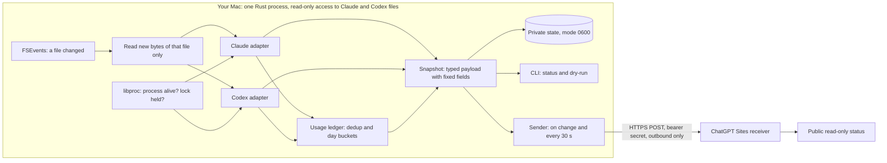

# agent-heartbeat design

**Status:** implemented and verified locally, revision 3, 2026-10-02. Revision 2 changed the runtime to one small Rust binary that reacts to file events; [Options considered](#options-considered) records why. Revision 3 records the results and one rule that live data corrected (the Codex turn rule).

## Contents

- [What this is](#what-this-is)
- [Privacy boundary](#privacy-boundary)
- [Sources and coverage](#sources-and-coverage)
- [Active-state rules](#active-state-rules)
- [Token accounting rules](#token-accounting-rules)
- [Coverage rules](#coverage-rules)
- [Options considered](#options-considered)
- [Architecture](#architecture)
- [Heartbeat timing](#heartbeat-timing)
- [Mac operation](#mac-operation)
- [Verification results](#verification-results)
- [Not verified yet](#not-verified-yet)

## What this is

`agent-heartbeat` is a local command-line tool for macOS. It counts two things:

- **Active agents.** These are the Claude Code and Codex agents that run a turn now.
- **Tokens today.** These are the tokens that these agents processed today, Seattle time.

The tool sends only these counts to the portfolio site, erickbenitez.com. There, the "Quiet terminal" panel shows them after the "On GitHub" section.

The work splits into two parts:

- **This repository** holds the local tracker, the contract, and a mock receiver.
- **A separate session** builds the receiving service and the panel on ChatGPT Sites. It implements against [CONTRACT.md](CONTRACT.md).

## Privacy boundary

The tracker reads local files. It sends only aggregate numbers.

| Leaves the machine | Never leaves the machine |
|---|---|
| The active agent count and its coverage | Prompts, responses, reasoning, tool input and tool output |
| Today's token counts (input, cached input, output, total) and their coverage | Project, repository, branch, file and task names; file paths |
| `observedAt`, `usageDate`, `timeZone` | Session, agent, thread, request and process identifiers |
| | Credentials, account details, model names, raw logs |
| | Screen contents and details of other applications |

The tool enforces the boundary in three ways:

1. **The adapters extract only allowlisted fields.** These are the token counts, timestamps, record types and stop reasons. Other fields stay in the source files. The tool keeps no content in memory or on disk.
2. **The snapshot builder constructs the payload field by field.** Then the tool validates the payload against `contract/heartbeat.v1.schema.json`. The schema has `additionalProperties: false` at every level. If validation fails, the tool sends nothing.
3. **The logs hold operational summaries only:** event names, HTTP status, timing and health states. A test scans the logs for planted secrets and fixture content.

The website never controls the machine:

- The tracker opens no listening port.
- The tracker makes outbound HTTPS requests only.
- The tracker ignores the response body except for the HTTP status.
- The tracker does not follow redirects, so the bearer secret cannot go to another host.

## Sources and coverage

The research used the installed tools: Claude Code 2.1.285 and Codex CLI 0.159.2. The Codex desktop app is part of ChatGPT.app. The research also used the official documentation as of 2026-10-02.

| Source | Token counts | Active state | Child agents | Limitations |
|---|---|---|---|---|
| **Claude Code transcripts**, `~/.claude/projects/**/*.jsonl` | Yes, per request: `message.usage` on each assistant record | No | Yes. Each child has its own file in `<session>/subagents/`. | The format is undocumented. The docs say the transcript "may lag". |
| **Claude Code session registry**, `~/.claude/sessions/<pid>.json` | No | Yes: `busy`, `waiting` (input or approval) or `idle`. It also has the process start time, to catch a reused process ID. | No. Children run inside the parent process. | The format is undocumented: the docs give the purpose only. Coverage of terminal and `claude -p` sessions is not yet verified live. |
| **Codex session files ("rollouts")**, `~/.codex/sessions/YYYY/MM/DD/rollout-*.jsonl` | Yes, per request: `token_usage_record` with a unique `response_id` | Turn start and end: `task_started`, then `task_complete` or `turn_aborted` | Yes. Each child has its own file, with `source.subagent`. | The docs say the format "isn't a stable interface". Waits for approval are not recorded. |
| **Codex thread locks**, `~/.codex/thread-writer-locks/<thread>.lock` | No | Is the owning process alive? The tracker lists the open files of the `codex` processes with `libproc`. It never takes the lock. | Yes. Children hold locks too. | Undocumented. It is the only way to tell a crashed turn from a running one. |
| **Claude Code hooks** (documented) | No | Yes, including the permission prompt | Exact: `SubagentStart` and `SubagentStop` | Needs a change to `~/.claude/settings.json`. Several hooks receive content on stdin. |
| **Codex hooks** (documented) | No | Yes, with `PermissionRequest` | Exact: `SubagentStart` and `SubagentStop` | Needs a change to the Codex config, and you must trust each hook. It is not documented whether hooks run in the desktop app. |
| **Claude Code OpenTelemetry** (documented) | Yes: `claude_code.token.usage` | No "active now" signal | Partly | Needs environment changes and a local receiver port. Each record carries the account email and UUID. |
| **Codex OpenTelemetry** (documented) | Partly. The token field names are not documented. | No | Partly | Needs a config change. By default, metrics go to OpenAI. |
| **Codex app-server** | Only for threads it owns | Only for threads it owns | No | It cannot see threads that another process owns, such as the desktop app's threads. |
| **Not covered** | — | — | — | The Claude desktop chat, claude.ai, Claude Code on the web, Codex cloud and remote sessions. They write nothing to this Mac. |

**Choice for version 1: read-only file adapters.** They need no change to Claude or Codex settings. They see the desktop apps, the CLIs and child agents. Hooks are the documented upgrade path for the two gaps below. Add them only after you approve the configuration change.

1. **Codex waits for approval.** These count as running, because the session files do not record them.
2. **A Claude child agent that stays silent for more than 10 minutes.** It counts as stalled, not running.

**Evidence from this Mac (2026-10-02)**

- **Codex records:** 8,787 records, and every `response_id` is unique, also across files. `total_tokens = input_tokens + output_tokens` held in all 8,787. `reasoning_output_tokens ≤ output_tokens` held in all 8,787.
- **Claude records:** each request is written once per content block. 15,623 records repeat an earlier request, and 5,294 of these have different usage, because output grows while the response streams. `usage.output_tokens` equals the sum of `usage.iterations[].output_tokens` in all 12,712 records that have iterations.
- **Claude child agents:** 105 of 110 finished child files end with an assistant record whose `stop_reason` is `end_turn`.
- **Claude registry:** a `busy` session matched child files that changed less than 2 minutes before. A session with no turn running showed `idle`.
- **Codex locks:** 5 session files have a turn with no end event, and no live process holds their lock. These are interrupted or crashed turns.
- **Silent gaps in Claude child files:** the median gap between records is 0.1 s. The 99th percentile is 53 s and the 99.9th percentile is 184 s. Of 49,281 gaps, 8 are longer than 10 minutes.

## Active-state rules

**Definition.** An agent is a Claude Code session, a Claude child agent, or a Codex thread (main or child). An agent is **active** when it runs a turn now. An open app or an idle CLI is not active.

| Case | Rule | Source |
|---|---|---|
| Claude session runs a turn | Active when the registry says `busy`, the process is alive, and its start time matches the registry. | Registry, `proc_pidinfo` |
| Claude session waits for input or approval | **Not active.** The registry says `waiting`. | Registry |
| Claude session is idle | Not active | Registry |
| Claude session is idle while a background shell command runs (status `shell`) | **Not active.** No turn runs. Otherwise a dev server that an agent started would keep the panel Online. | Registry |
| Claude process crashed | Not active. The process is gone, or a new process reuses the ID with a different start time. | `proc_pidinfo` |
| Claude child agent | Active when three conditions are true: the parent process is alive; the child's last record is not a finished assistant reply (`end_turn`, `stop_sequence` or `max_tokens`); and the child file changed in the last 10 minutes. | Transcripts, registry |
| Claude child runs after its parent's turn ends | Counts, if the child rule above is true. If the parent process ends, its children end too, because they run inside it. | Same |
| A tool runs for minutes without model output | **Active.** For a Claude session, the registry stays `busy`. For a Codex thread, the turn stays open and the lock stays held. For a Claude child, it is active for up to 10 minutes of silence (see the limitation above). | — |
| Codex thread runs a turn | Active when the thread's **latest** `task_started` has no matching `task_complete` or `turn_aborted`, and a live process holds the thread's lock. A thread runs one turn at a time, so a newer turn replaces an older one that never ended. (Seen live: a turn from 12 hours earlier had no end event.) | Rollouts, `libproc` |
| Codex thread waits for approval | **Counts as active (limitation).** The rollout records no approval event. Hooks would fix this. | — |
| Codex app or CLI crashed during a turn | Not active, because no process holds the lock. | `libproc` |
| Only one provider adapter works | The count is that provider's subtotal, with coverage `partial`. | — |
| No adapter works | `active: null`, with coverage `unavailable`. | — |

A parent that waits for its foreground child also counts as active, because its own turn still runs. "Active agents" therefore means agents with a running turn. It does not mean agents that produce tokens at this moment.

## Token accounting rules

**Total = processed input + output.** This is the definition in the handoff. It is also Codex's own `total_tokens`.

| Field | Claude (Anthropic usage) | Codex (OpenAI usage) |
|---|---|---|
| `input` (processed) | `input_tokens + cache_creation_input_tokens + cache_read_input_tokens`. The docs say these three are separate. | `input_tokens`. It already includes `cached_input_tokens` and `cache_write_input_tokens`. |
| `cachedInput` | `cache_read_input_tokens` | `cached_input_tokens` |
| `output` | `output_tokens`. Thinking is included. | `output_tokens`. `reasoning_output_tokens` is included. |

The tracker applies these rules:

1. **Count only per-request records.** Ignore cumulative snapshots: Codex `token_count.total_token_usage` and `thread_token_usage`, the Claude `cost-state` record, and the totals in a child agent's result. Each child's own file counts its own requests. So the tracker never counts a parent's inclusive total together with its children.
2. **Use one key for each request.** For Claude, the key is `message.id` and `requestId`. For Codex, it is `response_id`. The tool keeps a truncated SHA-256 of the key, never the key itself.
3. **Keep the per-field maximum for each key.** When a Claude request appears again with more output, add only the difference. When a record repeats, add nothing. This covers replays, restarts and re-reads after file rotation.
4. **Use the request time to choose the day.** The tool converts the record timestamp to `America/Los_Angeles` with the macOS time-zone database (`/usr/share/zoneinfo`, read by the `jiff` library), so daylight-saving changes are correct.
5. **Skip Claude `<synthetic>` records.** They report zero usage.
6. **Check the arithmetic.** If a Codex record has `total_tokens ≠ input_tokens + output_tokens`, or if cached input is more than input, the tool counts the record. It also marks the adapter `degraded` and reports the problem in the local health report.

**Reading files safely.** The tool keeps a cursor for each file: the inode, the size and the byte offset after the last complete line.

- **A partial last line:** the tool waits for the line to complete.
- **A shorter file or a new inode:** the tool reads the file again from the start. The per-request keys stop any double count.
- **A malformed line:** the tool skips it and counts it in the health report. It logs no content.
- **A very long line:** some Codex lines are 47 MB. The tool decides from the first 256 bytes whether it needs a line. It skips other lines without keeping them in memory, so memory stays bounded.
- **A record with missing required fields:** the tool skips it and marks the adapter `degraded`.
- **On the first run:** the tool reads only files that changed today.

**What the first run imports** (the default is A; set `"firstRun": "from-install"` in config.json for B):

- **(A) Import today. Recommended.** Count today's usage from the existing files. The number is correct on day one, and deduplication makes this safe.
- **(B) Count from installation.** Count only the requests after the first start. Today's number is low until midnight.

**This version does not estimate dollars or subscription limits.** Token counts are not a bill.

## Coverage rules

Coverage is relative to the sources in the local configuration. By default, these are `claude` and `codex`. Coverage is not relative to every session in your accounts.

| Adapter results | `coverage` | Numbers |
|---|---|---|
| Every configured adapter is healthy and up to date | `complete` | Exact |
| At least one adapter reports, and at least one does not | `partial` | A known subtotal (a lower bound). The site must not show it as a full total. |
| No adapter reports | `unavailable` | `null` |

- **Agents:** an adapter reports agents when its live-state source works. That is the registry for Claude, and the `libproc` lock check for Codex.
- **Tokens:** an adapter reports tokens when it has read every changed file to the end, with no `degraded` problem.

## Options considered

The goal is the lightest tracker that still meets the rules above. Measurements on this Mac, 2026-10-02:

| Cost | Measured |
|---|---|
| Data that the agents wrote to files that changed today | Codex 981 MB, Claude 168 MB |
| The part of the Codex data that the tracker needs | 4.5 MB (0.5%). A check of the first bytes of each line finds it. |
| `lsof` for the Codex locks | About 70 ms of CPU per call. At one call every 5 s, that is about 20 minutes of CPU a day. |
| The same check with `libproc`, `codex` processes only | 0.7 ms, with the same 8 locks found |
| Process start time with `proc_pidinfo` | 3 of 3 Claude registry entries matched, in 3 ms |

**Runtime**

| Option | Memory at idle | First-run import of today (1.15 GB) | Starts other processes | Dependencies | Result |
|---|---|---|---|---|---|
| **Rust** | **5.2 MB**, with a file watcher | **0.3 s CPU, 11 MB peak** | No | About 55 pinned packages | **Chosen** |
| Swift | 6.2 MB, with a file watcher | About 0.9 s CPU in a simpler prototype | No | None. It uses only the macOS frameworks. | Close second. It is the option if no third-party code is the priority. |
| Node | 12.7 MB with a timer only, before any work | Not measured | Yes: `ps` and `lsof`. Node cannot call `libproc`. | ajv | Rejected |
| Go | Not measured | Not measured | Needs cgo for FSEvents and `libproc` | — | Rejected. It has no advantage here. |

**How the tracker wakes up**

| Option | Wake-ups | Result |
|---|---|---|
| Poll every 5 s | About 17,000 a day, also when nothing changes | Rejected |
| **React to file events (FSEvents), plus one timer** | Only when an agent writes (at most once every 5 s), plus the keepalive | **Chosen** |
| launchd starts a short run every 15–30 s | 2,900–5,800 process starts a day. No instant update. | Rejected. A sleeping 5 MB process costs less than thousands of starts. |
| Hooks call the tracker | Exact events, but needs changes to your Claude and Codex settings | Possible later upgrade |
| OpenTelemetry | Needs settings changes and a local port. Each record carries your account email. | Rejected |

**When to send**

| Option | Requests a day (Mac awake all day) | Time until a crash shows as Offline | Result |
|---|---|---|---|
| Every 15 s, Offline after 60 s (the handoff proposal) | 5,760 | 60 s | Rejected |
| When the active count changes, plus every 30 s. The site uses a fixed 90 s limit. | About 2,900 | 90 s | Rejected. The site must know the tracker's timing. |
| **A lease: each heartbeat states its own `ttlSeconds`. Send on change, and every 30 s while agents run (lease 90 s) or every 120 s when none run (lease 300 s). On a clean stop, send lease 0.** | **At most about 2,900, and about 720 when idle all day** | 90 s while agents run. At once after a clean stop. | **Chosen.** This is the lease pattern of Kubernetes Lease and Consul TTL checks. The site needs no timing constant, and the tracker can change its timing alone. |

**Prior art** (survey of 2026-10-02). Nobody publishes coding-agent presence to a personal site yet, but each part has a precedent:

| Project | What we take from it |
|---|---|
| [toki](https://github.com/korjwl1/toki) (Rust, MIT) | The closest precedent: a daemon that uses `notify` (FSEvents) and incremental checkpoints, at about 5 MB idle. It reports that FSEvents can delay events for files that Codex keeps open. |
| [CodexBar](https://github.com/steipete/CodexBar) (Swift, MIT) | A cache of mtime, size and parsed bytes for each file. Process checks inside the process with `libproc`. |
| [ccusage](https://github.com/ccusage/ccusage) (Rust, MIT) | The Claude dedup key (`message.id` + `requestId`). It rereads every file on each run, so it is too heavy for a daemon, and its crates are not published. |
| [tmux-agent-status](https://github.com/rorhcdream/tmux-agent-status) (shell, MIT) | Also reads `~/.claude/sessions`, and Codex task events. It confirms the `shell` status. |
| WakaTime, ActivityWatch, Lanyard | Send on change plus a keepalive. The server decides presence. |
| Healthchecks, Uptime Kuma, Kubernetes Lease, Consul TTL | Period plus grace. A heartbeat that states its own expiry is the lease pattern. |

## Architecture

**One cycle**

1. FSEvents reports a changed file, or the keepalive timer fires.
2. The tracker reads only the new bytes of the changed files.
3. It checks process liveness with `libproc`, and only when the answer matters:
   - for Claude, when a registry entry says `busy` or a child file has not finished;
   - for Codex, when a turn is open.
4. It updates the active count and the usage ledger.
5. If the active count changed, it sends a heartbeat at once. Otherwise it sends one when 30 s have passed.

File events within 5 s are combined into one cycle.

When no agent writes, the process sleeps. It wakes only for the keepalive.

| Module | Role | Depends on the source format? |
|---|---|---|
| `src/tail.rs` | Reads new complete lines with cursors, rotation checks and a bounded buffer | No |
| `src/system.rs` | `libproc` checks: process start time, and lock files open in `codex` processes | No |
| `src/claude.rs` | The Claude adapter | Yes |
| `src/codex.rs` | The Codex adapter | Yes |
| `src/ledger.rs` | Deduplicates usage and buckets it by day | No |
| `src/snapshot.rs` | Builds the payload from a typed struct, and sets coverage | No |
| `src/state.rs` | Private state: atomic writes, mode 0600, bounded size | No |
| `src/sender.rs` | Timing, retries, backoff and wake detection | No |
| `src/secret.rs` | Reads the bearer secret from the Keychain once at startup, through `/usr/bin/security` | No |
| `mock/` | The mock receiver and the panel preview. A Node development tool, like the Cloudflare Worker it imitates. It is not part of the binary. | No |

If a source format changes, only that adapter changes.

**The secret goes through Apple's own `security` tool.** A Keychain item trusts the code signature of the program that reads it. A rebuilt binary has a new signature, so a direct read would ask for Keychain access after each upgrade, and launchd cannot answer that prompt. `/usr/bin/security` keeps one signature, so the tracker starts it once at startup to read the secret.

**The payload is a typed struct with fixed fields.** The type is the allowlist: the code cannot add a field without a compile-time change. A cross-language test checks the `dry-run` output against the JSON Schema with ajv.

## Heartbeat timing

| Setting | Value | Reason |
|---|---|---|
| Wake-up | On file events (FSEvents, combined over 5 s), plus the keepalive timer | No polling when nothing changes. One observation costs a few milliseconds, so the 5 s window keeps CPU near 0.1% of one core while agents write. The panel polls every 10–15 s, so visitors see no difference. |
| Heartbeat while agents run | On each change of the active count, and every 30 s. `ttlSeconds` = 90. | A change reaches the site within about 5 s. The site tolerates 2 lost heartbeats. |
| Heartbeat while no agent runs | Every 120 s. `ttlSeconds` = 300. | The panel shows Offline anyway. A slow lease changes only "0" versus "—" for up to 5 minutes after a crash. |
| Freshness on the site | Connected while `receivedAt + ttlSeconds` is in the future, by the site's clock | The tracker never decides freshness. |
| Clean stop | One heartbeat with `ttlSeconds` = 0 | The site shows Offline at once. When the Mac sleeps, the lease simply expires. |
| After sleep or a network gap | Send a new observation at once | The tool detects a jump in the wall clock. |
| Retries | Exponential backoff with full jitter: 2 s base, 60 s cap, 5 s timeout per request | Each retry builds a new snapshot. The tool never replays an old heartbeat. |
| HTTP 401 or 403 | Wait 5 minutes between attempts, and log once | A wrong secret does not cause a flood of requests. |
| Connection | HTTP keep-alive, macOS TLS, no redirects | One TLS handshake serves many heartbeats. The secret cannot go to another host. |
| Write load on the site | At most about 2,900 heartbeats a day | Within the Cloudflare D1 free tier |

## Mac operation

| Command | What it does |
|---|---|
| `agent-heartbeat status` | Shows the safe snapshot, the health of each adapter and the last send result. Local only. |
| `agent-heartbeat dry-run` | Prints the exact JSON that the tool would send. It sends nothing. |
| `agent-heartbeat start` / `stop` | Starts the tracker in the background, or stops it. |
| `agent-heartbeat run` | Runs the tracker in the foreground. launchd uses this command. |
| `agent-heartbeat secret generate` | Makes a random secret and stores it in the macOS Keychain. It prints only the SHA-256 hash, which the site stores. The secret itself never leaves the Mac except in the HTTPS header. |
| `agent-heartbeat launchd` | Writes a per-user LaunchAgent file. It does not load the file. |

| Path | Content | Limit |
|---|---|---|
| `~/Library/Application Support/agent-heartbeat/config.json` | The endpoint and the sources | — |
| `~/Library/Application Support/agent-heartbeat/state.json` | File cursors, hashed request keys, daily totals and the last send result. The directory is 0700 and the file is 0600. | Today and yesterday only |
| `~/Library/Logs/agent-heartbeat/agent-heartbeat.log` | Operational summaries | 256 KB × 2 files |

The tool never writes to `~/.claude` or `~/.codex`. To uninstall, see the README.

**Targets and results:** one binary of about 2 MB (measured: 1.3 MB); about 5 MB of memory at idle (measured: 8–10 MB); no CPU when nothing changes; no child processes (measured: none).

## Verification results

All checks ran on 2026-10-02. There were 43 Rust tests (`cargo test`) and 89 Node tests (`cd mock && npm test`); all passed. The Node tests include 9 end-to-end checks of the real binary, with live `sleep` processes as stand-in agents.

| # | Check | Evidence | Result |
|---|---|---|---|
| 1 | Several active sessions and child agents count correctly | `claude::counts_busy_sessions_and_running_children_only` (5 running from 2 busy sessions, 3 running children); `codex::running_needs_an_open_turn_and_a_held_lock`; end-to-end: 3 active from live processes | Pass |
| 2 | Idle, waiting and `shell` sessions do not count | The same Claude test; end-to-end "2 and 3" | Pass |
| 3 | Zero active agents produces Offline | End-to-end: `status: offline`, `tracker: connected`, active 0; receiver tests | Pass |
| 4 | A stopped tracker goes Offline | End-to-end: Offline at once after a clean stop (lease 0); Offline after the lease ends when killed; the live panel screenshot | Pass |
| 5 | A disconnection makes the count unknown, not zero | End-to-end: `active: null`, `coverage: unavailable`; the panel shows "—" | Pass |
| 6 | Restarts and replayed records do not double the tokens | Ledger tests; `engine::restart_from_saved_state_does_not_double_count`; end-to-end restart keeps 523 tokens | Pass |
| 7 | Partial writes, rotation, malformed records and format changes fail safely | `tail::*` (partial line, truncation, new inode, 3 MB skipped line, oversize line); adapter tests mark `degraded` with notes | Pass |
| 8 | The day changes at midnight Seattle time, including at daylight-saving changes | `time::*` on 2026-03-08 (23 h) and 2026-11-01 (25 h); `engine::a_request_before_seattle_midnight_belongs_to_yesterday` | Pass |
| 9 | An adapter that does not work produces explicit coverage | `engine::one_failed_adapter_gives_partial_coverage_and_a_subtotal`; missing homes give `unavailable` and `null` | Pass |
| 10 | The payload contains only approved fields | The typed struct; an exact-string test of the heartbeat JSON; ajv check of `dry-run` output; marker strings never appear | Pass |
| 11 | Secrets and raw source data never reach the logs | End-to-end scan of the log and state for the secret, content markers, thread, session and response IDs | Pass |
| 12 | Transport failures do not affect Claude or Codex | End-to-end: the tracker keeps running with an unreachable site; every source file is byte-identical except the ones the test itself changed; no child processes | Pass |

**Live checks on this Mac** (real files, read-only):

- **Tokens.** The tracker and an independent Python script gave the same total for today, 861.6M, and the same per-provider totals.
- **Claude active count.** It matched the independent script: 2 busy sessions plus 1 running child.
- **Codex active count.** This check found a rule error. A turn from 12 hours earlier had no end event, so the first rule counted its thread as running. The rule now counts only the thread's latest turn, and a regression test covers it.
- **Panel.** The tracker sent to the mock receiver, and the panel preview showed ONLINE with 3 agents. After `agent-heartbeat stop`, it showed OFFLINE with "—" within one panel refresh.
- **Keychain.** `secret generate`, then `status`, then `delete` all worked without a prompt. No history file appeared.

## Not verified yet

- **Terminal sessions.** Live coverage of the Claude terminal CLI and `claude -p` in the registry, and of `codex exec` and the Codex terminal CLI in the thread locks. The desktop apps are verified. Checking needs a short real session of each, which uses your subscription.
- **FSEvents delay for open Codex files.** toki reports that FSEvents can delay events for files that Codex keeps open. If that happens, a Codex change waits for the next keepalive (30 s or 120 s) instead of about 5 s. Not observed yet.
- **launchd.** The LaunchAgent file is generated and checked as text. It is not loaded.
- **The production receiver on ChatGPT Sites.** It does not exist yet.
- **A full day.** The longest run so far is minutes, not a day. Not yet seen live: day rollover, sleep and wake, and a correction of yesterday's total.
